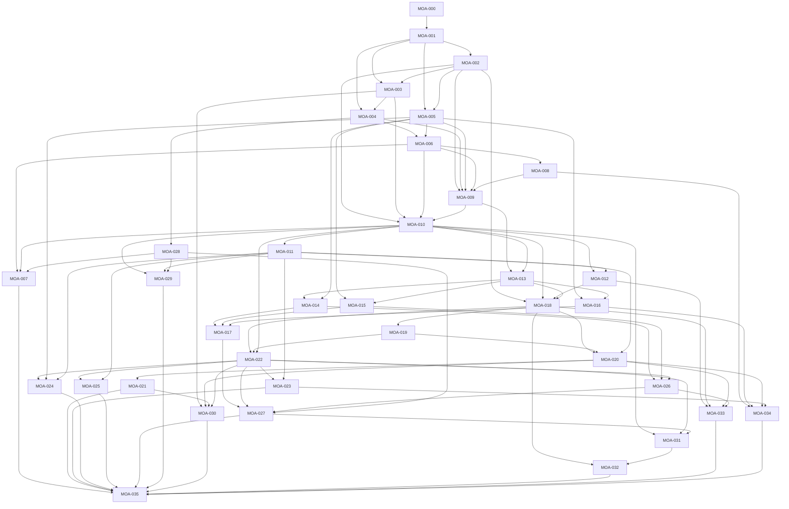

# Dependencias entre issues

> Generado por `scripts/planning.py`; editar los catálogos JSON y regenerar.

Una flecha A → B significa que B requiere A completado. El checker rechaza ciclos, referencias desconocidas e inversiones de fase.

## Orden topológico válido

MOA-000 → MOA-001 → MOA-002 → MOA-003 → MOA-004 → MOA-005 → MOA-006 → MOA-008 → MOA-009 → MOA-010 → MOA-028 → MOA-007 → MOA-011 → MOA-012 → MOA-013 → MOA-014 → MOA-015 → MOA-016 → MOA-017 → MOA-018 → MOA-019 → MOA-020 → MOA-021 → MOA-022 → MOA-023 → MOA-024 → MOA-025 → MOA-026 → MOA-027 → MOA-029 → MOA-030 → MOA-031 → MOA-032 → MOA-033 → MOA-034 → MOA-035

El orden no obliga a ejecutar secuencialmente issues independientes. El siguiente issue listo se obtiene de dependencias completadas, no del número menor.
