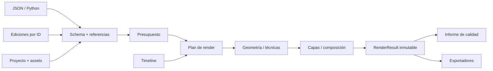

# Arquitectura

Contrato normativo: [MOANA.md](../../MOANA.md), especialmente §§3–6 y 11–16. Este documento explica decisiones; no duplica las reglas de rasterización.

Este diseño es **planificado**; consulta la [visión general](overview.md) y los [contratos por módulo](module-contracts.md).

## Fronteras

El dominio mantiene datos inmutables y enteros. Los adaptadores raster intercambian máscaras y buffers con propiedad clara. El orquestador resuelve dependencias y presupuesto una sola vez por solicitud. La capa de exportación no cambia el documento y no necesita conocer el editor. La capa de proyecto puede usar la API de edición para historial, pero el editor no depende de disco.

Evitar «god modules» de dibujo y un registro dinámico de plugins ejecutables. El registro de operaciones es explícito: modelo, capability, estimación de coste y raster asociados por discriminador. Toda nueva técnica atraviesa los mismos límites y tests. La API traduce errores de bibliotecas a errores de dominio sin perder la causa para diagnóstico.

## Estado de carpetas

El paquete contiene `src/moana/__init__.py`, `py.typed` y `src/moana/core/` (MOANA-001) `src/moana/schema/` (MOANA-002) y `src/moana/render/` (plan de coste MOANA-003 y orquestador MOANA-010); `schemas/` guarda el JSON Schema generado. Los módulos descritos en MOANA.md se crean al implementar sus issues. `scripts/` contiene herramientas del repositorio y no se distribuye en el wheel. `examples/specs/` expresa diseño; `minimal.moana.json` ya se renderiza con `moana.render.render`.

## Decisiones

- [ADR-001: documento declarativo e IDs](ADR-001-declarative-document.md).
- [ADR-002: rasterización entera](ADR-002-pixel-contract.md).
- [ADR-003: dependencias y entornos](ADR-003-toolchain.md).
- [ADR-004: alcance de agentes y automatización](ADR-004-agent-infrastructure.md).
- [ADR-005: backends y fronteras](decisions/ADR-005-backends-and-boundaries.md).
- [ADR-006: identidad y ciclo del backlog](decisions/ADR-006-backlog-identity-and-lifecycle.md).
- [ADR-007: clarificaciones de contratos](decisions/ADR-007-contract-clarifications.md).
- [ADR-008: tooling portable](decisions/ADR-008-portable-tooling.md).
- [ADR-009: capa de Claude Code](decisions/ADR-009-claude-code-layer.md).
- [ADR-010: contratos de core](decisions/ADR-010-core-contracts.md).
- [ADR-011: schema 1.0 del documento](decisions/ADR-011-schema-v1.md).
- [ADR-012: presupuestos de solicitud](decisions/ADR-012-request-budgets.md).
- [ADR-013: lienzo RGBA y adaptadores](decisions/ADR-013-canvas-buffer.md).
- [ADR-014: paletas, lenguajes de ID y luminancia](decisions/ADR-014-palette.md).
- [ADR-015: primitivas raster enteras, máscaras y flood fill](decisions/ADR-015-raster-primitives.md).
- [ADR-016: transformaciones pixel-perfect sobre índices](decisions/ADR-016-pixel-transforms.md).
- [ADR-017: árbol de capas y composición source-over entera](decisions/ADR-017-layers-composition.md).
- [ADR-018: orquestador de render determinista, máscaras diferidas y `budget-v2`](decisions/ADR-018-render-pipeline.md).
- [ADR-019: exportación PNG verificada y escritura atómica sin sobrescritura](decisions/ADR-019-png-export.md).
- [ADR-020: fachada pública `moana.api` y CLI estático `moana`](decisions/ADR-020-public-api-cli.md).
- [ADR-021: contrato de determinismo entre procesos y plataformas](decisions/ADR-021-cross-platform-determinism.md).
- [ADR-022: máscaras semánticas en DAG, regiones por ID y `budget-v3`](decisions/ADR-022-masks-regions.md).
- [ADR-023: paths de punto fijo con el backend `aggdraw-v1` y `budget-v4`](decisions/ADR-023-aggdraw-paths.md).
- [ADR-024: batches de edición atómicos, revisión optimista y `moana edit`](decisions/ADR-024-atomic-edits.md).
- [ADR-025: dithering ordenado Bayer con cobertura entera, anclaje explícito y `budget-v5`](decisions/ADR-025-ordered-dithering.md).
- [Modelo de amenazas](SECURITY_MODEL.md).

Un ADR nuevo registra contexto, decisión, alternativas, consecuencias y evidencia. Cambiar un ADR aceptado se hace mediante otro que lo sustituya y actualizando el contrato principal.
