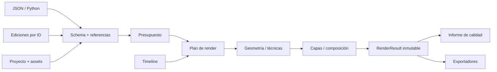

# Arquitectura

Contrato normativo: [MOANA.md](../../MOANA.md), especialmente §§3–6 y 11–16. Este documento explica decisiones; no duplica las reglas de rasterización.

## Fronteras

El dominio mantiene datos inmutables y enteros. Los adaptadores raster intercambian máscaras y buffers con propiedad clara. El orquestador resuelve dependencias y presupuesto una sola vez por solicitud. La capa de exportación no cambia el documento y no necesita conocer el editor. La capa de proyecto puede usar la API de edición para historial, pero el editor no depende de disco.

Evitar «god modules» de dibujo y un registro dinámico de plugins ejecutables. El registro de operaciones es explícito: modelo, capability, estimación de coste y raster asociados por discriminador. Toda nueva técnica atraviesa los mismos límites y tests. La API traduce errores de bibliotecas a errores de dominio sin perder la causa para diagnóstico.

## Estado de carpetas

`src/moana/__init__.py` y `py.typed` son los únicos artefactos del paquete inicial. Los módulos descritos en MOANA.md se crean al implementar sus issues. `scripts/` contiene herramientas del repositorio y no se distribuye en el wheel. `examples/specs/` expresa diseño, no demuestra render.

## Decisiones

- [ADR-001: documento declarativo e IDs](ADR-001-declarative-document.md).
- [ADR-002: rasterización entera](ADR-002-pixel-contract.md).
- [ADR-003: dependencias y entornos](ADR-003-toolchain.md).
- [ADR-004: alcance de agentes y automatización](ADR-004-agent-infrastructure.md).
- [Modelo de amenazas](SECURITY_MODEL.md).

Un ADR nuevo registra contexto, decisión, alternativas, consecuencias y evidencia. Cambiar un ADR aceptado se hace mediante otro que lo sustituya y actualizando el contrato principal.
