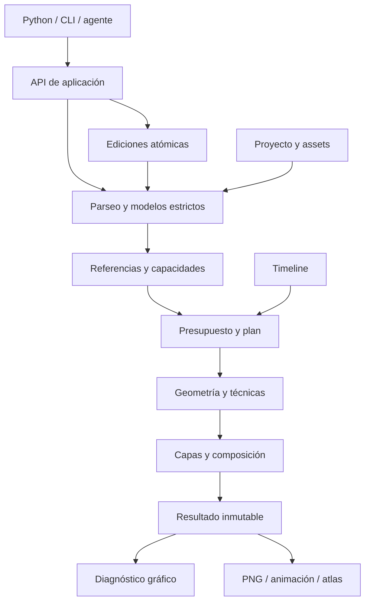

# Arquitectura prevista de Moana

Estado: **diseño para implementación**. El paquete actual implementa `core` (con el lienzo RGBA), `schema`, `palette`, `geometry` (primitivas, flood fill, transformaciones y paths AggDraw `aggdraw-v1`, ADR-023), `techniques` (dithering ordenado, contornos por morfología Chebyshev, análisis de clusters, sombreado por bandas y presets de materiales con contorno selectivo, ADR-025, ADR-027, ADR-028 y ADR-030), `editing` (batches atómicos por ID e historial undo/redo en memoria, ADR-024 y ADR-026), `project` (persistencia confinada y atómica de proyectos, assets e historial, y migraciones explícitas de formato, ADR-029 y ADR-031), `animation` (timeline con frames evaluados contra la base y render en streaming con presupuesto acumulado, ADR-032), `quality` (informes de calidad con hard checks, advertencias suprimibles por región y métricas, ADR-036, y validación de la rúbrica del corpus artístico, ADR-037), `layers` (árbol, composición y máscaras por capa, ADR-022) `render` (plan de coste y orquestador determinista) `export` (PNG RGBA/indexado con escritura atómica y spritesheets en grid con manifiesto reversible, ADR-033, y GIF con política explícita de pérdidas, ADR-034, y APNG/WebP lossless opcionales según capacidades del codec, ADR-035) y `api`/`cli` (fachada y comando estático `moana`, ADR-020) (ver [module-contracts.md](module-contracts.md)); el resto de cajas de este documento no representan módulos ya entregados. La fuente normativa es [MOANA.md](../../MOANA.md). El [índice de arquitectura](README.md) conserva las decisiones originales y [module-contracts.md](module-contracts.md) concreta las fronteras.

## Propósito y límites del sistema

Moana transforma un documento declarativo en píxeles y artefactos exportados. La aplicación anfitriona o el agente decide qué dibujar, autoriza los paths de entrada/salida y presenta el resultado al usuario. El motor valida datos, controla recursos, rasteriza de forma determinista y conserva la identidad de elementos editables. No contiene un proveedor de IA, una GUI, una red de servicios ni scripts ejecutables suministrados por el documento.

Un ejemplo de recorrido futuro es: el agente crea el ID `eye_left`, valida el documento, obtiene un `RenderResult`, exporta un PNG y muestra el preview. Una revisión cambia ese ID en una copia del documento. El PNG no sustituye al documento fuente y el cambio no depende de otra llamada a un generador de imágenes.

Las flechas muestran flujo de datos; las dependencias de imports se rigen por MOANA.md §3. En particular, el núcleo no importa la fachada, los exportadores ni almacenamiento. `quality` no modifica el resultado. La fachada reúne informes y exports sin convertirlos en dependencias del rasterizador.

## Documento y propiedad de estado

El documento conserva IDs, orden explícito, paleta, operaciones y referencias. El plan resuelve esos datos para una ejecución acotada. Los buffers internos tienen un único propietario; los resultados públicos son copias o superficies inmutables sin acceso indirecto a un array escribible. Los adaptadores no filtran objetos mutables de Pillow o NumPy hacia el contrato público.

Capas, grupos y regiones cumplen papeles diferentes: una capa ordena composición; un grupo aplica transformación/opacidad de forma conjunta; una región identifica semánticamente una máscara y operaciones. «Ojo izquierdo» se resuelve a una región/ID, no a una búsqueda heurística en el PNG. La paleta se referencia por IDs para permitir remapeos globales y duplicaciones locales intencionales.

## Determinismo y compatibilidad

La garantía base compara dimensiones y bytes RGBA normalizados, no la representación comprimida de un PNG. El documento normalizado, renderer, backend y versiones de dependencias identifican una ejecución. Semillas se derivan de IDs y coordenadas; el orden de arrays define composición. Se prueban procesos nuevos y plataformas antes de declarar portabilidad.

El perfil entero fija las decisiones de borde y redondeo. AggDraw es una capacidad complementaria identificada por backend, con su propia evidencia. Pillow provee intercambio, buffers y codecs; NumPy provee matrices. Ninguna biblioteca garantiza calidad artística. El [ADR-005](decisions/ADR-005-backends-and-boundaries.md) explica estas elecciones sin sustituir el contrato de píxel del [ADR-002](ADR-002-pixel-contract.md).

Schema, renderer y distribución tienen versiones distintas. Un campo futuro no se ignora porque la versión del paquete sea mayor: el lector acepta versiones/capacidades explícitas y las migraciones preservan el original. El formato de proyecto añade assets y persistencia al documento, manteniendo la validación de datos y de rutas separada.

## Estrategia incremental

Las fases P0–P5 del [roadmap](../issues/roadmap.md) se conservan para respetar el DAG existente. Son puertas de entrega, no una obligación de crear carpetas vacías por fase. Primero se implementan tipos/límites, después modelos y buffers, luego imagen estática, técnicas/edición, persistencia/animación y endurecimiento. Cada módulo se crea cuando se trabaja su issue; las interfaces aquí descritas no justifican stubs sin comportamiento.

La evaluación combina pruebas matemáticas, propiedades, integración, regresión visual y revisión humana. La planificación de esos controles no es evidencia de que ya se hayan aplicado a sprites. Véanse los [estándares de testing](../standards/testing.md) y el [modelo de amenazas](SECURITY_MODEL.md).
