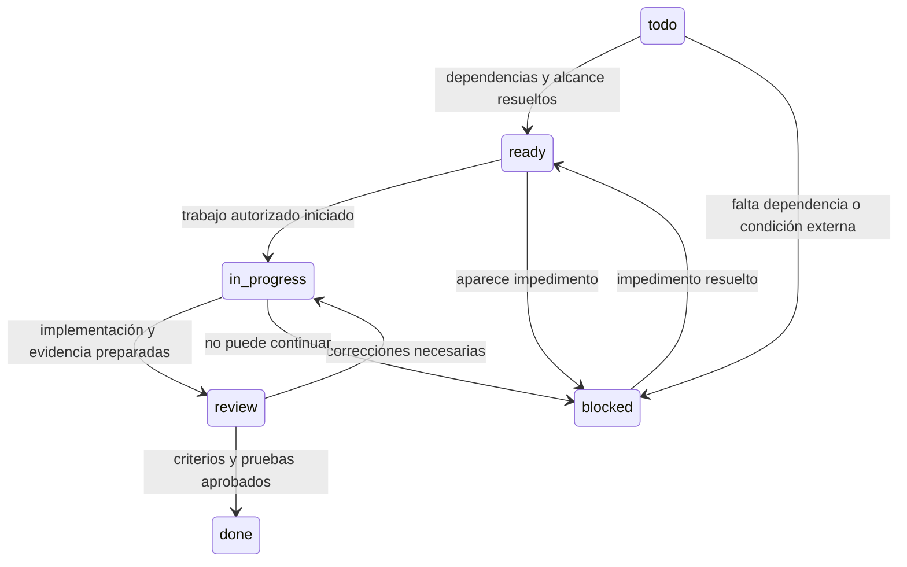

# Ciclo de vida de issues

La fuente editable es [catalog.json](../issues/catalog.json); [requirements.json](../requirements.json) define requisitos y secciones de MOANA.md. Los Markdown, índices, roadmap y mapa se generan mediante `scripts/planning.py`. No mantener dos descripciones manuales del mismo trabajo.

## Identidad y metadatos

Los IDs canónicos son `MOANA-000`…`MOANA-035`. Los antiguos `MOA-xxx` se conservan como aliases de compatibilidad del mismo issue; no cuentan como tareas nuevas. Una referencia histórica sigue resolviendo al trabajo original. Los IDs de GitHub, si se publican después, son otra identidad y no reemplazan al ID local.

Cada issue contiene fase, prioridad, estado, complejidad, dependencias directas, módulos relacionados, contexto, objetivo, alcance/exclusiones, requisitos, propuesta, aceptación, pruebas, entregables, DoD y riesgos. Un criterio debe ser observable: entrada, resultado esperado y evidencia. «Calidad alta» sin rúbrica o comparación no basta.

| Prioridad | Significado |
| --- | --- |
| P0 | Fundamento o bloqueo de otros entregables |
| P1 | Funcionalidad principal |
| P2 | Funcionalidad avanzada |
| P3 | Mejora opcional |

Complejidad S/M/L/XL es una estimación relativa de alcance/incertidumbre, no una promesa de horas. Las fases P0–P5 son gates de entrega independientes de la prioridad P0–P3. Una fase posterior no puede bloquear un issue de una fase anterior sin revisar la planificación.

## Estados y transiciones



| Estado | Condición verificable |
| --- | --- |
| `todo` | Registrado, todavía sin preparar para ejecución |
| `ready` | Dependencias completas, alcance y pruebas suficientes, sin bloqueo conocido |
| `in_progress` | Trabajo en curso dentro de una solicitud autorizada |
| `blocked` | Dependencia pendiente o restricción externa descrita con condición de desbloqueo |
| `review` | Entregables y evidencia listos para evaluar; no equivale a aceptación |
| `done` | Dependencias completas, todos los criterios/pruebas cumplidos y evidencia registrada |

Las dependencias incompletas bloquean ejecución; el orden numérico no las sustituye. Resolver un bloqueo obliga a reevaluar dependencias antes de volver a `ready`. Si un issue cerrado necesita corregirse, registrar la causa y un alcance explícito para reabrirlo o crear un defecto relacionado; no eliminar silenciosamente su evidencia histórica. Un estado describe trabajo real, no el deseo de finalizar una fase.

## Procedimiento de actualización

1. Editar los campos del issue en `catalog.json` y los requisitos afectados cuando cambie alcance.
2. Documentar motivo de bloqueo o evidencia de cierre; identificar comando, entorno, resultado y artefacto pertinente.
3. Regenerar y comprobar:

```sh
uv run python scripts/planning.py
uv run python scripts/planning.py --check
uv run python -m scripts.check_repository
```

4. Revisar el diff del issue, roadmap, dependencias y trazabilidad; verificar que no se hayan añadido duplicados o requisitos huérfanos.
5. Reflejar el cambio en GitHub con autorización para escribir en el repositorio remoto:

```sh
uv run python scripts/github_sync.py          # dry run: muestra las escrituras
uv run python scripts/github_sync.py --apply  # labels, milestones, issues y dependencias
```

## Espejo en GitHub

El catálogo es la fuente de verdad; GitHub es un espejo regenerable. `scripts/github_sync.py` (idempotente, vía `gh` autenticado) mantiene:

- **Issues**: título `MOANA-xxx — título`; cuerpo igual al documento generado, con la sección «Guía para agentes de IA» y enlaces convertidos a issues y archivos de `main`. Los issues `done` se cierran como completados. La correspondencia ID → número queda en [github-map.json](../issues/github-map.json).
- **Milestones**: uno por fase (`P0 — Inicialización` … `P5 — Evaluación y release`), con su puerta de salida; se cierran cuando todos sus issues están `done`.
- **Labels**: `moana`, `phase:Px`, `priority:Px`, `complexity:S|M|L|XL`, `status:<estado>` y `module:<módulo>`.
- **Dependencias**: relaciones nativas «blocked by» de GitHub, una por arista del DAG.

No editar issues, labels ni dependencias directamente en GitHub: la siguiente sincronización los sobrescribe. Para cambiar alcance o estado, editar el catálogo, regenerar y sincronizar.

La validación estructural detecta referencias, ciclos y estados incoherentes; no puede demostrar por sí sola que una descripción de evidencia sea verdadera. El responsable del cambio debe ejecutar las pruebas y el revisor contrastarlas. Un baseline cambiado sin justificación no es evidencia de corrección.

## Cierre de fase y selección siguiente

Cada fase tiene una puerta explícita en el [roadmap](../issues/roadmap.md). Una fase se considera terminada cuando sus issues requeridos y su evidencia cumplen esa puerta, no cuando existe su documentación. La [matriz](../issues/traceability.md) muestra cobertura de planificación, que debe distinguirse de cobertura implementada.

El [mapa de dependencias](../issues/dependency-map.md) incluye dependientes, orden válido y oportunidades de paralelismo. Su ruta crítica estructural indica la cadena de dependencias más profunda; sin duraciones medidas no representa una predicción de calendario. El primer módulo previsto es MOANA-001, una vez verificado el gate de infraestructura.
