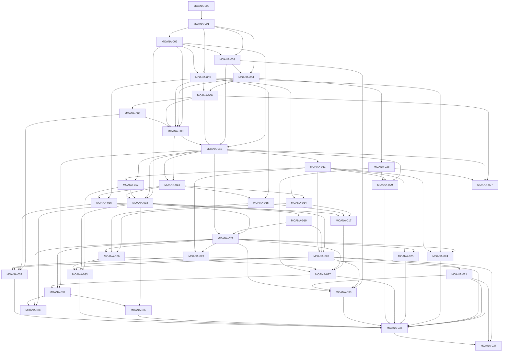

# Dependencias entre issues

> Generado por `scripts/planning.py`; editar los catálogos JSON y regenerar.

A → B significa que B requiere A completado. El checker rechaza ciclos, referencias desconocidas, inversiones de fase y estados activos con dependencias pendientes.

## Bloqueantes y dependientes

| Issue | Bloqueado por | Desbloquea directamente |
| --- | --- | --- |
| [MOANA-000](MOANA-000.md) | — | MOANA-001 |
| [MOANA-001](MOANA-001.md) | MOANA-000 | MOANA-002, MOANA-003, MOANA-004, MOANA-005 |
| [MOANA-002](MOANA-002.md) | MOANA-001 | MOANA-003, MOANA-005, MOANA-009, MOANA-010, MOANA-018 |
| [MOANA-003](MOANA-003.md) | MOANA-001, MOANA-002 | MOANA-004, MOANA-010, MOANA-030 |
| [MOANA-004](MOANA-004.md) | MOANA-001, MOANA-003 | MOANA-006, MOANA-009, MOANA-028 |
| [MOANA-005](MOANA-005.md) | MOANA-001, MOANA-002 | MOANA-006, MOANA-009, MOANA-014, MOANA-015, MOANA-016, MOANA-024 |
| [MOANA-006](MOANA-006.md) | MOANA-004, MOANA-005 | MOANA-007, MOANA-008, MOANA-009, MOANA-010 |
| [MOANA-007](MOANA-007.md) | MOANA-006, MOANA-010, MOANA-028 | MOANA-035 |
| [MOANA-008](MOANA-008.md) | MOANA-006 | MOANA-009, MOANA-034 |
| [MOANA-009](MOANA-009.md) | MOANA-002, MOANA-004, MOANA-005, MOANA-006, MOANA-008 | MOANA-010, MOANA-013 |
| [MOANA-010](MOANA-010.md) | MOANA-002, MOANA-003, MOANA-006, MOANA-009 | MOANA-007, MOANA-011, MOANA-012, MOANA-013, MOANA-018, MOANA-022, MOANA-029, MOANA-031 |
| [MOANA-011](MOANA-011.md) | MOANA-010 | MOANA-012, MOANA-020, MOANA-023, MOANA-024, MOANA-025, MOANA-029 |
| [MOANA-012](MOANA-012.md) | MOANA-010, MOANA-011 | MOANA-018, MOANA-033 |
| [MOANA-013](MOANA-013.md) | MOANA-009, MOANA-010 | MOANA-014, MOANA-015, MOANA-016, MOANA-018 |
| [MOANA-014](MOANA-014.md) | MOANA-013, MOANA-005 | MOANA-017, MOANA-026 |
| [MOANA-015](MOANA-015.md) | MOANA-005, MOANA-013 | MOANA-017, MOANA-026 |
| [MOANA-016](MOANA-016.md) | MOANA-005, MOANA-013 | MOANA-017, MOANA-034 |
| [MOANA-017](MOANA-017.md) | MOANA-014, MOANA-015, MOANA-016 | MOANA-027 |
| [MOANA-018](MOANA-018.md) | MOANA-002, MOANA-010, MOANA-012, MOANA-013 | MOANA-019, MOANA-020, MOANA-022, MOANA-032, MOANA-033, MOANA-036 |
| [MOANA-019](MOANA-019.md) | MOANA-018 | MOANA-020, MOANA-022 |
| [MOANA-020](MOANA-020.md) | MOANA-018, MOANA-019, MOANA-011 | MOANA-021, MOANA-030, MOANA-033, MOANA-034, MOANA-037 |
| [MOANA-021](MOANA-021.md) | MOANA-020 | MOANA-030, MOANA-035, MOANA-037 |
| [MOANA-022](MOANA-022.md) | MOANA-018, MOANA-019, MOANA-010 | MOANA-023, MOANA-024, MOANA-025, MOANA-026, MOANA-027, MOANA-030, MOANA-031, MOANA-036 |
| [MOANA-023](MOANA-023.md) | MOANA-022, MOANA-011 | MOANA-034, MOANA-035 |
| [MOANA-024](MOANA-024.md) | MOANA-022, MOANA-005, MOANA-011 | MOANA-035 |
| [MOANA-025](MOANA-025.md) | MOANA-022, MOANA-011 | MOANA-035 |
| [MOANA-026](MOANA-026.md) | MOANA-014, MOANA-015, MOANA-022 | MOANA-027, MOANA-033 |
| [MOANA-027](MOANA-027.md) | MOANA-017, MOANA-022, MOANA-026, MOANA-028 | MOANA-031, MOANA-035 |
| [MOANA-028](MOANA-028.md) | MOANA-004 | MOANA-007, MOANA-027, MOANA-029 |
| [MOANA-029](MOANA-029.md) | MOANA-010, MOANA-011, MOANA-028 | MOANA-035 |
| [MOANA-030](MOANA-030.md) | MOANA-003, MOANA-020, MOANA-021, MOANA-022 | MOANA-035 |
| [MOANA-031](MOANA-031.md) | MOANA-010, MOANA-022, MOANA-027 | MOANA-032, MOANA-036 |
| [MOANA-032](MOANA-032.md) | MOANA-018, MOANA-031 | MOANA-035 |
| [MOANA-033](MOANA-033.md) | MOANA-012, MOANA-018, MOANA-020, MOANA-026 | MOANA-035 |
| [MOANA-034](MOANA-034.md) | MOANA-008, MOANA-016, MOANA-020, MOANA-023 | MOANA-035 |
| [MOANA-035](MOANA-035.md) | MOANA-007, MOANA-021, MOANA-023, MOANA-024, MOANA-025, MOANA-027, MOANA-029, MOANA-030, MOANA-032, MOANA-033, MOANA-034 | MOANA-037 |
| [MOANA-036](MOANA-036.md) | MOANA-018, MOANA-022, MOANA-031 | — |
| [MOANA-037](MOANA-037.md) | MOANA-020, MOANA-021, MOANA-035 | — |

## Ruta crítica estructural

MOANA-000 → MOANA-001 → MOANA-002 → MOANA-003 → MOANA-004 → MOANA-006 → MOANA-008 → MOANA-009 → MOANA-010 → MOANA-011 → MOANA-012 → MOANA-018 → MOANA-019 → MOANA-022 → MOANA-026 → MOANA-027 → MOANA-031 → MOANA-032 → MOANA-035 → MOANA-037

Es la cadena más larga por número de issues, con desempate lexicográfico. Sin duraciones estimadas no representa una ruta crítica de calendario.

## Oleadas potencialmente paralelizables

Son niveles del DAG, no permisos de ejecución ni estados ready. En una oleada, cada dependencia debe estar done y deben asignarse archivos distintos antes de delegar.

- Nivel 0: MOANA-000
- Nivel 1: MOANA-001
- Nivel 2: MOANA-002
- Nivel 3: MOANA-003, MOANA-005
- Nivel 4: MOANA-004
- Nivel 5: MOANA-006, MOANA-028
- Nivel 6: MOANA-008
- Nivel 7: MOANA-009
- Nivel 8: MOANA-010
- Nivel 9: MOANA-007, MOANA-011, MOANA-013
- Nivel 10: MOANA-012, MOANA-014, MOANA-015, MOANA-016, MOANA-029
- Nivel 11: MOANA-017, MOANA-018
- Nivel 12: MOANA-019
- Nivel 13: MOANA-020, MOANA-022
- Nivel 14: MOANA-021, MOANA-023, MOANA-024, MOANA-025, MOANA-026
- Nivel 15: MOANA-027, MOANA-030, MOANA-033, MOANA-034
- Nivel 16: MOANA-031
- Nivel 17: MOANA-032, MOANA-036
- Nivel 18: MOANA-035
- Nivel 19: MOANA-037

## Orden recomendado válido

MOANA-000 → MOANA-001 → MOANA-002 → MOANA-003 → MOANA-004 → MOANA-005 → MOANA-006 → MOANA-008 → MOANA-009 → MOANA-010 → MOANA-028 → MOANA-007 → MOANA-011 → MOANA-012 → MOANA-013 → MOANA-014 → MOANA-015 → MOANA-016 → MOANA-017 → MOANA-018 → MOANA-019 → MOANA-020 → MOANA-021 → MOANA-022 → MOANA-023 → MOANA-024 → MOANA-025 → MOANA-026 → MOANA-027 → MOANA-029 → MOANA-030 → MOANA-031 → MOANA-032 → MOANA-033 → MOANA-034 → MOANA-035 → MOANA-036 → MOANA-037
