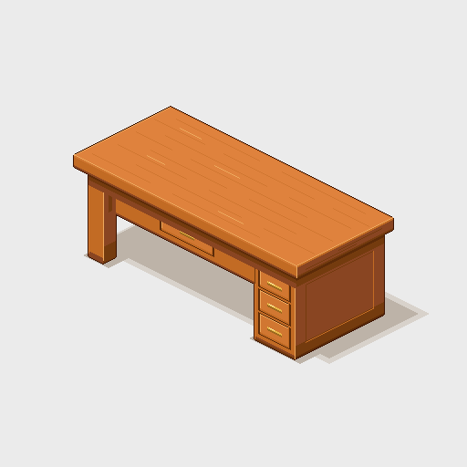

# Escritorio isométrico 512 × 512

Escritorio de madera en perspectiva isométrica 2:1, dibujado de forma nativa en un lienzo de 512 × 512: tablero con veta y cantos iluminados, pata, faldón con cajón central, cajonera con tres cajones y tiradores de latón, sombra proyectada en el suelo y sombras sólidas escalonadas bajo el tablero. Paleta strict de 14 colores, 8 capas y máscaras semánticas.



## Archivos e historial de edición

| Archivo | Contenido |
| --- | --- |
| `desk-r0.moanart.json` | Revisión 0: geometría, paleta y sombras tramadas (dithering ordenado 4 × 4). |
| `desk-solid-shadows.edit.json` | Batch de 32 comandos sobre la revisión 0: borra las seis operaciones `dither` y sus máscaras, inserta bandas sólidas escalonadas (vuelo del tablero, oclusión cerca del suelo, halo de suelo) y oscurece los grises de sombra con `replace_palette_color`. |
| `desk-r1.moanart.json` | Revisión 1, el resultado del primer batch y la base del segundo. |
| `desk-deeper-overhang.edit.json` | Batch de 5 `set_geometry` sobre la revisión 1: alarga la sombra del vuelo del tablero a 12 filas al frente y 10 en el lateral. |
| `desk.moanart.json` | Revisión 2, el resultado de aplicar ambos batches. |
| `previews/desk-1x.png` | Render a 1× de la revisión 2. |

Reproducir el historial y la imagen:

```sh
moanart edit examples/desk/desk-r0.moanart.json examples/desk/desk-solid-shadows.edit.json
moanart export examples/desk/desk.moanart.json desk-4x.png --scale 4
```

`tests/integration/test_desk_example.py` comprueba que los dos batches reproducen exactamente `desk.moanart.json` (mismo `snapshot_digest`), que el primero sustituye todas las operaciones `dither`, que la preview versionada es el render del documento final y que el render sólo usa colores opacos de la paleta.

## Procedencia

La referencia fue un sprite isométrico de 192 × 192 aportado por el propietario del repositorio (no se incluye). Este escritorio no es una copia: es una reinterpretación a resolución nativa de 512 × 512 escrita como documento MoanArt por un agente de IA (Claude) y editada después con `moanart edit`. Las coordenadas de la revisión 0 se calcularon con un script auxiliar de proyección isométrica que no forma parte del repositorio; desde entonces la fuente es el documento.

Licencia: MIT ([LICENSE](../../LICENSE)). Revisión artística humana: pendiente.
